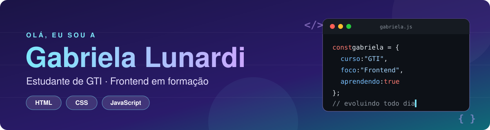

  

  
  

 

## 👩‍💻 Sobre mim

Sou estudante de **Gestão da Tecnologia da Informação (GTI)** e estou no início da minha jornada na área de tecnologia. Gosto de aprender na prática: estudo **desenvolvimento frontend** e já uso **lógica de programação** e **pensamento computacional** para resolver desafios e construir meus primeiros projetos.

| 🎓 Formação | 💡 Foco atual | 🎯 Objetivo |
|:---|:---|:---|
| Gestão da Tecnologia da Informação | HTML, CSS e JavaScript | Ganhar experiência e evoluir na área de TI |

 

## 🛠️ Tecnologias e ferramentas

  
  
  
  
  
  

**Também no meu dia a dia:** lógica de programação, pensamento computacional e o uso de IA como apoio aos estudos.

 

## 📂 Projetos

<table>
  <tr>
    <td width="50%" valign="top">
      <h3>📈 <a href="https://github.com/GabrielaLunardi/Dashboard-porsche-sales">Dashboard Porsche Sales</a></h3>
      Dashboard de vendas de modelos da Porsche.  
      
    </td>
    <td width="50%" valign="top">
      <h3>🌐 <a href="https://github.com/GabrielaLunardi/Trilha-HTML-modulo-1">Trilha HTML – Módulo 1</a></h3>
      Página web com estrutura básica, usando as tags aprendidas na Formação HTML Web Developer.  
      
    </td>
  </tr>
  <tr>
    <td width="50%" valign="top">
      <h3>🎮 <a href="https://github.com/GabrielaLunardi/Calculadora-de-partidas-rankeadas">Calculadora de Partidas Rankeadas</a></h3>
      Calculadora de partidas rankeadas (desafio DIO).  
      
    </td>
    <td width="50%" valign="top">
      <h3>🏆 <a href="https://github.com/GabrielaLunardi/Desafio-Classificador-de-nivel">Classificador de Nível</a></h3>
      Classificador de nível (desafio DIO).  
      
    </td>
  </tr>
  <tr>
    <td width="50%" valign="top">
      <h3>🧩 <a href="https://github.com/GabrielaLunardi/Classes-de-um-jogo">Classes de um Jogo</a></h3>
      Criação das classes de um jogo (desafio DIO).  
      
    </td>
    <td width="50%" valign="top">
      <h3>🤝 <a href="https://github.com/GabrielaLunardi/dio-lab-open-source">DIO Lab Open Source</a></h3>
      Lab "Contribuindo em um Projeto Open Source no GitHub".  
      
    </td>
  </tr>
</table>

 

---

  💬 Vamos trocar ideias? Me encontre no <a href="https://www.linkedin.com/in/gabriela-lunardi-823712422/"><b>LinkedIn</b></a>.

